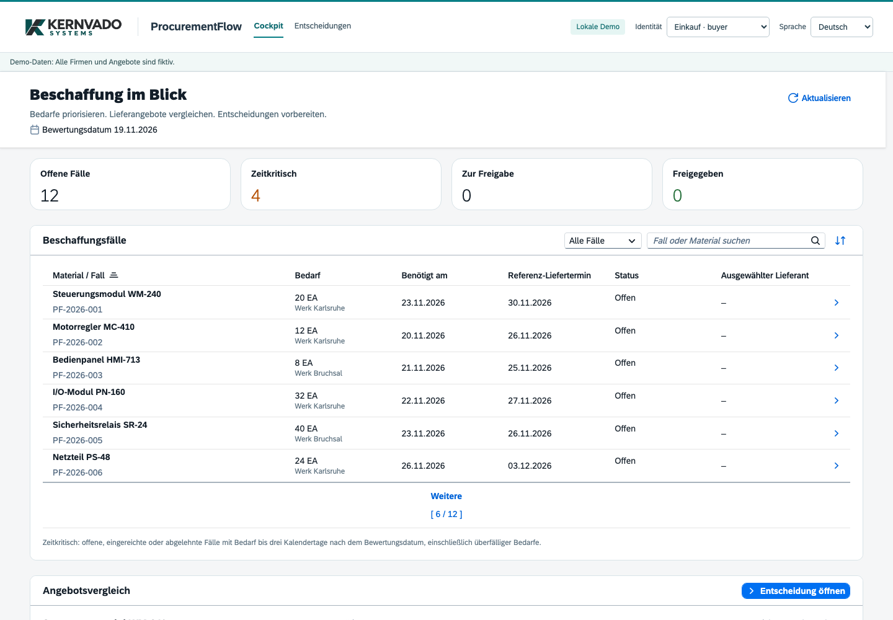
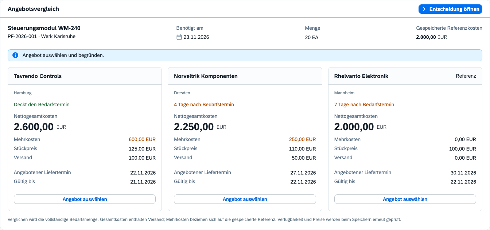

# ProcurementFlow


ProcurementFlow ist eine SAP-Demo für den Einkauf des fiktiven Herstellers **KERNVADO Systems**. Die App vergleicht Lieferangebote, führt Entscheidungen durch Einreichung und Freigabe und überträgt sie an einen eigenständigen ERP-Testdienst.

**[Öffentliche Demo öffnen](https://1dd6463atrial-procurementflow-pf-router.cfapps.us10-001.hana.ondemand.com)** · Deutsch und Englisch · Keine SAP-Anmeldung erforderlich

Die Demo läuft in SAP BTP Trial. Ihre Verfügbarkeit hängt von den laufenden Apps und der HANA-Datenbank ab. Bei einer vorübergehenden Abschaltung lässt sich derselbe App-Stand lokal starten.



## Was die Demo zeigt

- SAPUI5-Freestyle-Cockpit mit zwölf Beschaffungsfällen, Suche, Sortierung, Angebotsvergleich und Terminübersicht.
- Fiori Elements mit Entwürfen, Begründungen, Einreichung, Freigabe, Ablehnung und Verlauf.
- Serverseitige Kostenberechnung, Rollenprüfung und Erkennung konkurrierender Änderungen.
- Dauerhafte ERP-Übertragung mit Wiederholung und Schutz vor Doppelbestellungen.
- Öffentliche Besuchersitzungen mit eigenen Fällen, Rollenwechsel und persönlicher ERP-Ausfallsimulation.

Alle Firmen, Angebote und Geschäftsdaten sind fiktiv. Der ERP-Testdienst ist eine Simulation; die Übertragung erfolgt über echte HTTP-Aufrufe. Der Projektcode wurde mit Unterstützung von AI-Werkzeugen entwickelt und durch automatisierte Tests geprüft.

## In drei Minuten ausprobieren

1. In der öffentlichen Demo **PF-2026-001** öffnen und das Angebot von **Tavrendo Controls** auswählen.
2. Entscheidung und Mehrkosten begründen, speichern und in **Entscheidungen** öffnen.
3. Einreichen und über die Demo-Rolle **Freigabe** freigeben. Anschließend den Übertragungsstatus bis **Bestellt** verfolgen.
4. Für den Fehlerfall vor der Freigabe **Demo-Szenario → ERP-Ausfall simulieren** wählen. Nach **Simulation beenden** die Übertragung wiederholen.

**Dual** erlaubt in der öffentlichen Demo den vollständigen Ablauf einschließlich eigener Freigabe. Der reguläre lokale Ablauf verwendet das Vier-Augen-Prinzip. **Demo neu starten** setzt in der öffentlichen App ausschließlich die eigene Besuchersitzung zurück. [Bedienung und Rollen](docs/demo.md).



## Lokal starten

Voraussetzungen: **Node 24.22.3**, **npm 11.20.0** und eine Internetverbindung für das versionierte SAPUI5-CDN.

```sh
npm ci
npm ci --prefix erp
npm run demo
```

Danach [localhost:4004](http://localhost:4004) öffnen. Der Starter legt fehlende SQLite-Datenbanken an und startet App und ERP-Testdienst auf Port 4004 beziehungsweise 4005. Strg+C beendet beide Prozesse. Bestehende Daten bleiben erhalten.

Die lokale Oberfläche bietet die Identitäten `buyer`, `approver`, `reader` und `dual`. Ihre bewusst öffentlichen Demo-Zugangsdaten stehen in der [Bedienungsanleitung](docs/demo.md#lokale-demo-identitäten). Das öffentliche Sitzungsmodell lässt sich lokal mit `CDS_ENV=public-demo npm run demo` starten.

## Prüfen und bauen

Zusätzlich zu den obigen Abhängigkeiten:

```sh
npm ci --prefix deployment/approuter
npx playwright install chromium
npm run check
npm run build:mta
```

`npm run check` führt Typprüfung, Backendtests, Produktionsbuild, einen HTTP-Smoke-Test und die Browserabläufe aus. Die Browserprüfungen verwenden eigene Datenbanken und den gebauten AppRouter; automatische Testwiederholungen sind ausgeschaltet. [Entwicklung, Container und Prüfungen](docs/development.md).

Der GitHub-Workflow ist für diesen Repository-Stand vorbereitet. Sein tatsächlicher Status ergibt sich nach Veröffentlichung aus den ausgeführten Actions-Läufen.

## Aufbau

| Bereich | Inhalt |
|---|---|
| `app/` | SAPUI5 Freestyle, Fiori Elements und gemeinsame Oberfläche |
| `srv/`, `db/` | CAP-Service, Fachmodell, Workflow und Übertragungsworker |
| `erp/` | Eigenständiger ERP-Testdienst |
| `test/` | Fach-, API-, Persistenz- und Browserprüfungen |
| `deployment/`, `mta.yaml` | AppRouter, HDI und BTP-Paket |
| `infra/`, `Dockerfile`, `compose.yaml` | Terraform-Vorlage und lokaler Containerbetrieb |

[Architektur](docs/architecture.md) · [Fachbegriffe](docs/domain.md) · [BTP-Deployment](docs/deployment.md) · [Optionale Erweiterungen](docs/roadmap.md)

Der Umfang dieses Repositorys ist die bestehende Demo-App. Die Git-Historie beginnt mit einem zusammengeführten, geprüften Stand; die vorherige Entwicklung wurde nicht als nachträgliche Commit-Serie rekonstruiert.

## Lizenz

**UNLICENSED.** Für den eigenen Projektcode wird keine Open-Source-Lizenz vergeben. Abhängigkeiten und SAPUI5 unterliegen ihren jeweiligen Lizenzbedingungen. SAPUI5 wird vom offiziellen CDN geladen und nicht in dieses Repository kopiert.
