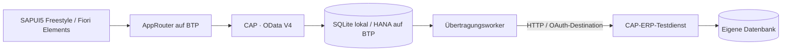

# Architektur

ProcurementFlow führt eine Beschaffungsentscheidung vom Angebotsvergleich bis zur bestätigten ERP-Testbestellung. Zwei Oberflächen verwenden denselben CAP-Service und dieselben Geschäftsdaten.

Lokal erreichen die Oberflächen CAP direkt. Der AppRouter gehört zum BTP-Paket und wird zusätzlich in den Browserprüfungen eingesetzt. Der ERP-Testdienst besitzt einen eigenen Prozess und eine eigene Datenbank.

| Verantwortung | Code |
|---|---|
| Modell, Fälle, Einreichungen und Historie | [db/schema.cds](../db/schema.cds) |
| OData-Vertrag und Rollen | [procurement-service.cds](../srv/procurement-service.cds) |
| Kosten, Termine und Begründungen | [rules.ts](../srv/lib/rules.ts) |
| Transaktionen und Versionskonflikte | [workflow.ts](../srv/lib/workflow.ts) |
| Fiori-Entwürfe | [workspaces.ts](../srv/lib/workspaces.ts) |
| Besuchersitzungen und Datentrennung | [srv/demo](../srv/demo) |
| Dauerhafte Übertragung und Wiederholung | [outbox.ts](../srv/integration/outbox.ts), [worker.ts](../srv/integration/worker.ts) |
| ERP-Vertrag und Duplikatschutz | [order-contract.ts](../erp/srv/lib/order-contract.ts) |
| Individueller Angebotsvergleich | [Cockpit](../app/cockpit/webapp) |
| Entwurf und Freigabe | [Fiori Elements](../app/decisions/webapp) |

## Entscheidung, Entwurf und Freigabe

Ein Beschaffungsfall bündelt Bedarf, Angebote und Entscheidung. Eine Einreichung hält die ausgewählten Konditionen fest. Ein Fiori-Entwurf ist ein bearbeitbarer Zwischenstand; erst beim Sichern übernimmt der gemeinsame Workflow die Entscheidung.

Geldbeträge werden serverseitig mit Dezimalarithmetik berechnet. Eine Entscheidung benötigt eine Begründung; ab 500 EUR Mehrkosten ist zusätzlich eine Mehrkostenbegründung erforderlich. Ein Angebotsfingerprint erkennt veränderte Konditionen vor der Freigabe.

Schreibaktionen verlangen die angezeigte Fallversion. Eine bedingte Datenbankänderung beansprucht diese Version; Fall, Einreichung und Historie werden in derselben Transaktion aktualisiert. Veraltete Änderungen scheitern mit einem Konflikt. Die UI wiederholt eine abgewiesene fachliche Aktion nicht stillschweigend.

Der Verlauf beschreibt den gespeicherten Fall. Seine Fiori-Bindung verwendet den aktiven Workspace, damit eine verspätete Abfrage auch nach der Aktivierung eines Entwurfs gültig bleibt. [Regressionstest](../test/e2e/draft-history.spec.ts).

## ERP-Übertragung

Die Freigabe speichert den Übertragungsauftrag zusammen mit dem fachlichen Zustand. Ein Worker beansprucht ihn mit einer befristeten Reservierung und sendet die festgehaltenen Konditionen an `POST /erp/Orders`. Erst eine passende Antwort setzt den Fall auf **Bestellt**.

Die Operation-ID bleibt bei Wiederholungen unverändert. Der ERP-Testdienst liefert für dieselbe ID und dieselben Konditionen dieselbe Bestellung; abweichende Konditionen führen zu einem Konflikt. Damit bleibt auch eine verlorene Antwort nach bereits gespeicherter Bestellung beherrschbar. Prozessneustarts, konkurrierende Worker und Wiederholungen werden getestet.

Eine fehlgeschlagene Übertragung nimmt die Freigabe nicht zurück. Fachstatus und technischer Übertragungsstatus bleiben getrennt. Der öffentliche ERP-Ausfallschalter wirkt vor dem Versand ausschließlich auf Übertragungen der eigenen Besuchersitzung; er stoppt keinen gemeinsam genutzten Dienst.

## Rollen und Besucherdaten

Die geschützte Produktionskonfiguration verwendet AppRouter/XSUAA. Der öffentliche Demo-Modus wird ausdrücklich aktiviert und ordnet jeder Besuchersitzung eigene Fälle, Entwürfe, Einreichungen und Historieneinträge zu. Serverseitige Rollen- und Datenprüfungen bleiben wirksam. Cookies, Origin-Prüfung und CSRF-Schutz sichern die Sitzungsaktionen ab; abgelaufene Besucherdaten werden bereinigt.

Im regulären Ablauf darf der Einreicher seine Entscheidung nicht selbst freigeben. Die ausdrücklich ausgewiesene Ausnahme gilt nur für die simulierte öffentliche Rolle **Dual**. Ein Rollenwechsel demonstriert Berechtigungen; er ersetzt keine Anmeldung zweier realer Personen.

## Grenzen

Alle Firmen und Angebote sind fiktiv. Der ERP-Testdienst ist eine Simulation mit echtem HTTP-Vertrag, kein S/4HANA-System. Das feste Bewertungsdatum steuert die Demo unabhängig von der tatsächlichen Uhrzeit. Historieneinträge behalten reale Zeitstempel.

Die Anwendung ist eine Portfolio-Demo. Produktionsbetrieb, eine native RAP-Ausführung und eine Verbindung über Cloud Connector gehören nicht zum aktuellen Umfang. [Optionale Erweiterungen](roadmap.md).
